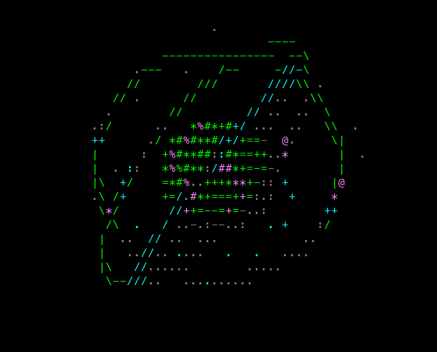
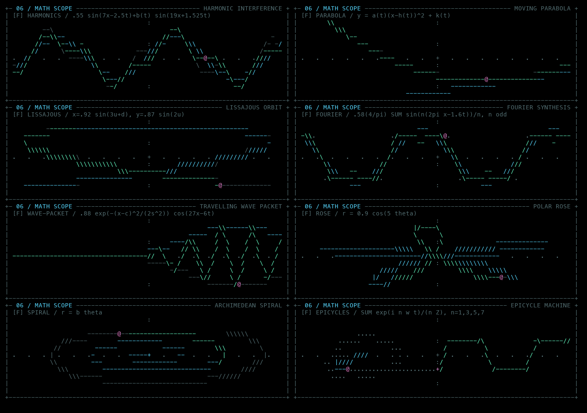
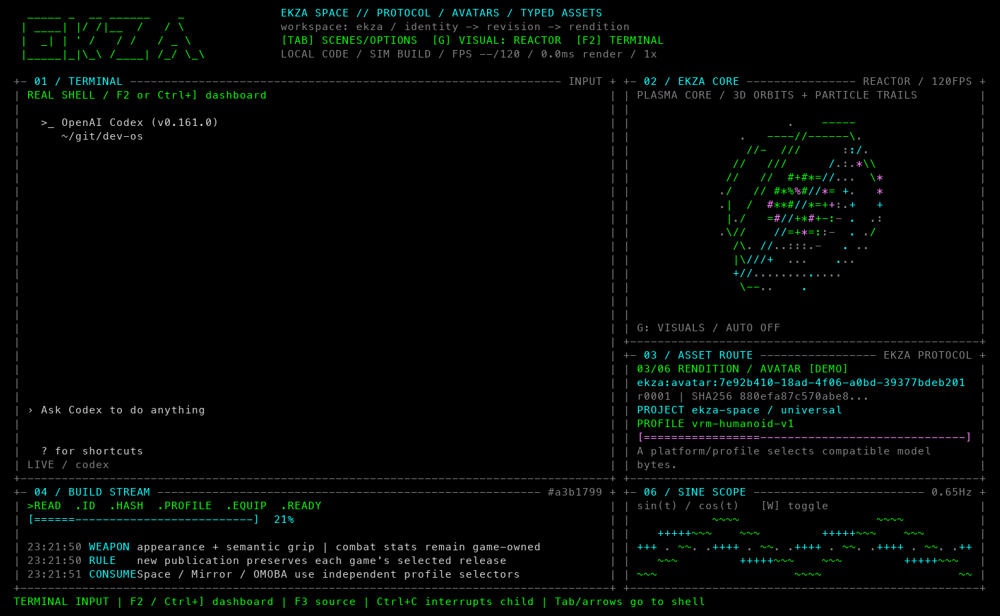
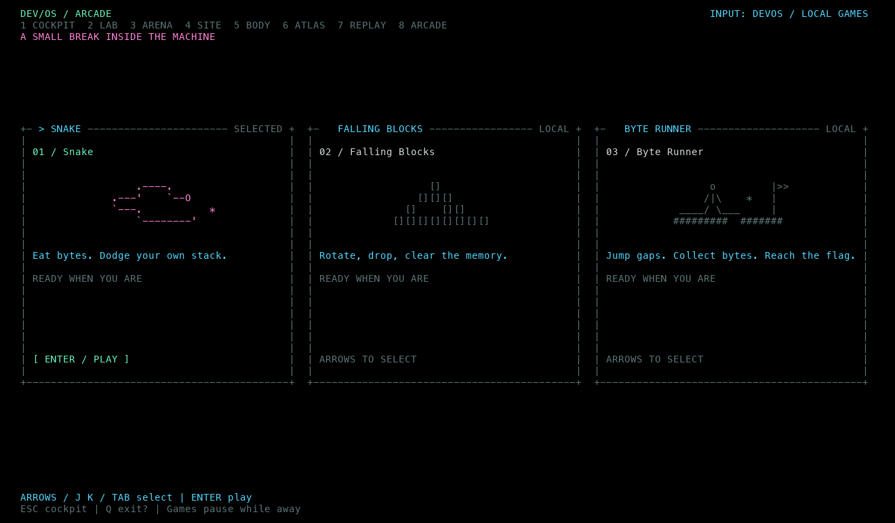

# Vibe Reactor Console

**The core spins. The code ships.**

A terminal cockpit that started as a fake coding simulator and got carried away:
ASCII reactors, real project source, two interactive terminals, bounded agent
missions, live data adapters, replay — and an arcade for the build breaks.

[English](README.md) · [Русский](README.ru.md)

[](docs/screenshots/reactor.png)

**Python 3.9+ · macOS / Linux · No third-party Python runtime dependencies**

Use it as a visual toy, a coding workspace, or a display for your own signals.
The default session is **DEMO**. Real commands, data connections, recordings and
managed agent missions start through explicit actions or launch arguments.
The interface distinguishes **DEMO**, **LIVE** and **REPLAY**; missing data stays `--`.

## Start here

```bash
git clone https://github.com/wotori/vibe-reactor-console.git
cd vibe-reactor-console
python3 dev_console.py
```

Run in an interactive terminal. A window of **120×36** or larger exposes the
extra panels; the layout adapts down to **48×16**. Your terminal's background is
preserved by default, including black and transparency settings.

Try the reactor, your own source code, or a game:

```bash
python3 dev_console.py --animation reactor --background black
python3 dev_console.py --project-root /path/to/project --animation reactor
python3 dev_console.py --screen arcade
```

The reactor is available through **G → PLASMA REACTOR → Enter**.
Press **Y** to make the visual fullscreen; **Esc** restores the layout.

Optionally install the command in a virtual environment:

```bash
python3 -m venv .venv
source .venv/bin/activate
python3 -m pip install -e .
vibe-reactor-console --animation reactor
```

`python3 -m devos`, `devos` and `dev_show.py` remain compatible entry points.
The internal Python package and existing settings directory are still named `devos`.

## Eight screens, one slightly excessive console

| Key | Screen | What it does |
| --- | --- | --- |
| **1** | Cockpit | Source or a real terminal beside graphics, events and math |
| **2** | Visual Lab | Bind a signal to a visual parameter; inspect its age and quality |
| **3** | Agent Arena | Demo, two interactive CLIs, or explicit bounded agent missions |
| **4** | Site Observatory | Aggregate audience metrics and a page constellation |
| **5** | Body Signal | BPM/RR data and an artistic pulse; not an ECG |
| **6** | Ekza Atlas | Asset protocol examples, or a real Git tree with source and diff |
| **7** | Replay Studio | Recorded events, bookmarks, seeking and Arena reconstruction |
| **8** | Arcade | Snake, falling blocks and an original ASCII platformer |

**P** or **/** opens command search. **?** opens help.
**O / Shift+O** selects a panel; **Z** zooms it.
Screens share visual preferences, and switching screens keeps child processes alive.

## Graphics with a terminal-sized ego

Choose from **12 visuals** using **G**:

- Plasma Reactor, Gravity Well, Torus Knot and Twin Core.
- Packet Garden, Voxel Tide and Asset Orrery.
- T-pose Avatar, Solid Cube, Asset Sphere and a mathematically projected 4D Tesseract.
- Ekza Asset Flow: identity → revision → rendition → approval → verification → consumer.

Source scenes and graphics are independent. **Tab** chooses a scene: Ekza,
Bare Metal (C and x86-64 assembly), Dev Lab, or Hyperspace. In either picker,
**← / →** switches between the content list and shared options.

**Math Scope** has eight animated functions: harmonic interference, a moving
parabola, Lissajous curves, Fourier synthesis, a travelling wave packet, a polar
rose, an Archimedean spiral and epicycles. **F** changes the function;
**W** toggles the panel; **X** makes it fullscreen.

[](docs/screenshots/math-scope.png)

```bash
python3 dev_console.py --mode bare-metal --animation reactor
python3 dev_console.py --animation sphere --fps 120 --auto-cycle 15
python3 dev_console.py --scope-mode parabola --scope-auto-cycle 15
```

**A** cycles the main visual automatically. Math has its own auto-cycle setting.
**T** changes the palette; **B** switches between the native terminal background
and forced black. In 256-color terminals, forced black uses color 16 (`#000000`).
The frame cap is **60 FPS** by default, adjustable from 10 to 120; actual throughput
depends on your terminal and window size.

## Source from your own project

Press **U**, enter a project folder and confirm. **N** chooses another random
source file; **R** rereads the current file. The SOURCE panel types real excerpts
with file paths and real line numbers. Displaying code never executes it.

Scanning and reading run in a bounded background worker. Hidden files, binary
files, symlinks, common secret filenames, and build/dependency directories are
skipped. Filename filtering cannot detect secrets inside an ordinary source file;
choose the folder with your intended audience in mind.

Without a selected project, scenes show bundled snippets, or matching local
Ekza files if available. Provenance is visible: **PROJECT**, **LOCAL** or
**SNAPSHOT**. The built-in Ekza protocol animation explains avatar/asset contracts;
its example IDs, revisions and hashes are **DEMO**, not results from a live catalog.
See [source provenance](docs/ekza-sources.md).

Preferences save automatically to `$XDG_CONFIG_HOME/devos/settings.json`
(normally `~/.config/devos/settings.json`): visual, background, palette, speed,
FPS, math, bindings, selected screen and project folder. **S** saves immediately.
Use `--no-config` for a session that neither reads nor writes preferences.
Precedence is **saved settings → preset → explicit CLI arguments**.

```bash
python3 dev_console.py --list-presets
python3 dev_console.py --preset showcase
```

A preset deliberately reapplies its composition. To resume your saved reactor
selection next time, launch without `--preset showcase`.

## Real terminals and two agents

Install **tmux** separately to enable embedded terminals. The rest of the app
works without it. You can run a shell, Codex, Claude or another installed CLI:

```bash
python3 dev_console.py --terminal --animation reactor
python3 dev_console.py --command codex --cwd /path/to/project
python3 dev_console.py --screen arena --agents watch \
  --command codex --right-command claude
```



- **F2 / Ctrl+]** transfers keyboard ownership between the dashboard and terminal.
- **F3** switches source/terminal display without terminating the child program.
- **F4** focuses the other terminal slot. Both appear side by side at **160×36** or larger.
- In a focused terminal, ordinary keys go to its program; **Ctrl+C** interrupts it.

The embedded terminals use a private temporary tmux server. Existing tmux sessions
and configuration are left alone. Terminal snapshots update independently of the
visual frame cap. Mouse input, terminal image protocols and OSC clipboard/links
are not forwarded; some emoji widths may differ from a native terminal.

**Watch** mode is human-driven: it does not automatically exchange prompts.
**Relay** and **Mission** modes support explicit public handoffs and finite task
graphs with handoff/time limits, separate working folders and local check results.
They require installed compatible CLIs, your own model access and an explicit
`--mission`. **!** stops a managed mission from the dashboard.
See [Agent Arena](docs/agent-arena.md) for scenarios and limits.

For a model-free preview:

```bash
python3 dev_console.py --preset duet
```

## Bring your own signals

Generic adapters accept aggregate JSON files, an HTTP(S) endpoint, JSONL files
or a FIFO. Heart-rate input uses a separate local JSON bridge. These adapters do
not install analytics on your website or connect a wearable by themselves.

```bash
# Fixed fixtures that demonstrate the input contract, not real measurements.
python3 dev_console.py --screen site --source-file examples/site.json
python3 dev_console.py --screen body --binding pulse --heart-file examples/heart.json

# Your own aggregate endpoint; missing live data stays unavailable.
python3 dev_console.py --screen site --data-mode live \
  --source-url https://your-site.example/api/metrics

# Real repository data; D toggles the Git view in Atlas.
python3 dev_console.py --screen atlas --git-root /path/to/project
```

Bindings can drive energy, particle count and other visual parameters from
online/pulse/tests/queue signals. **V** cycles a binding; **L** edits its range,
linear/log mapping, smoothing and missing-data behavior. Smoothing affects the
picture; the displayed measurement, age and quality remain explicit.

A local check is configured with `--task 'your command'` and only starts through
**P → Task / run configured check**. Its actual exit code, revision and output
are available in the result inspector.

See [input schemas, freshness and examples](docs/data-sources.md).

## Record, replay and share a composition

```bash
python3 dev_console.py --record /tmp/reactor-session.jsonl
python3 dev_console.py --replay /tmp/reactor-session.jsonl
```

Replay is isolated from live actions: recorded events never launch commands.
**Space** plays/pauses, **[ / ]** seeks, **M** adds a bookmark during recording,
and **, / .** changes replay speed. The command palette exposes Arena
reconstruction, public mission reports and scene capsule export. Capsules contain
portable preferences, not commands, credentials or local project paths.

Recordings exclude personal pulse, terminal text and prompts by default;
`--record-pulse` explicitly includes pulse data. **Stream View** hides terminal
text, paths, personal signals and agent messages for display; recording has its
own separate rules. See [the workbench guide](docs/workbench.md).

## Build breaks deserve an arcade



Press **8**, choose with **arrows / J / K / Tab**, press **Enter** to open a game,
and **Enter** again to start. Search **/ → Arcade** also works.

| Game | Controls and features |
| --- | --- |
| **Snake** | Arrows/WASD; food, growth, collisions and increasing speed |
| **Falling Blocks** | ←/→ move, ↑ rotates, ↓ soft drop, Space hard drop; seven-piece bag, ghost, next preview and line clears |
| **Byte Runner** | ←/→ move; ↑/W/Space jumps; coins, enemies, springs, checkpoints and a finish flag |

**P** pauses, **Enter** resumes, **R** restarts. **Esc** returns to the game lobby;
another Esc returns to Cockpit. **/** opens command search while playing.
Each game keeps its round in memory when switching screens, but does not restore
it after application restart or include it in Replay. Hidden games and menus
pause the game clock; terminals and work tasks continue independently.
Byte Runner is an original ASCII platformer with its own Byte Valley level.

Screenshots: [Snake](docs/screenshots/arcade-snake.png) ·
[Falling Blocks](docs/screenshots/arcade-blocks.png) ·
[Byte Runner](docs/screenshots/arcade-runner.png).

## Everyday keys

These apply when the dashboard owns the keyboard. Games have their own controls.

| Key | Action |
| --- | --- |
| **1–8** | Switch screen |
| **Tab / G** | Scene picker / visual picker |
| **P / /** | Command search |
| **?** | Help |
| **Space** | Pause/resume visuals |
| **+ / −** | Speed: 0.25×–8× |
| **T / B / A** | Palette / background / visual auto-cycle |
| **F / W / X / Y** | Next math function / math panel / fullscreen math / fullscreen visual |
| **U / N / R** | Project folder / next source / reread source |
| **O / Shift+O / Z** | Next panel / previous panel / zoom |
| **F2 / Ctrl+] / F3 / F4** | Terminal focus / focus / source display / other terminal |
| **Q / Ctrl+C** | Open exit confirmation |

Exit confirmation defaults to **Stay**. **Enter / N / Esc** returns to work;
**Y**, or selecting **Exit** and pressing Enter, closes the application and its
embedded terminals. Repeated Q does not confirm. Fullscreen exits with the same
key, **Esc** or **Z**. An explicit `--duration` exits on its timer without a dialog.
On some Macs, use **Fn** with function keys.

## Development and deeper documentation

```bash
python3 -m unittest discover -s tests -v
```

Tests cover pure simulation, geometry, rendering bounds, persistence, source
workers, data freshness, game engines, replay and real terminal behavior when
tmux is available. Agent tests use local fake processes, not paid model calls.
Windows without curses is unsupported. Terminal processes, managed coordinator
state and game rounds are not restored after restart.

The runtime separates scene state, pure rendering, bounded worker snapshots and
explicit actions. The `devos/games/` registry holds independent game engines;
`screen_registry.py` defines screens and their shared UI/terminal layout contract.
Detailed documentation is currently mostly in Russian:

- [Implementation status](docs/implementation.md) and [changelog](CHANGELOG.md).
- [Workbench, bindings and replay](docs/workbench.md).
- [Data adapters and schemas](docs/data-sources.md).
- [Agent Arena](docs/agent-arena.md).
- [Ekza source provenance](docs/ekza-sources.md).
- [Evolution specification](docs/evolution/README.md).
- [Full Russian README](README.ru.md).

Repository rules for contributors and coding agents:
[AGENTS.md](AGENTS.md) and [development workflow](.agents/skills/devos-workflow/SKILL.md).
