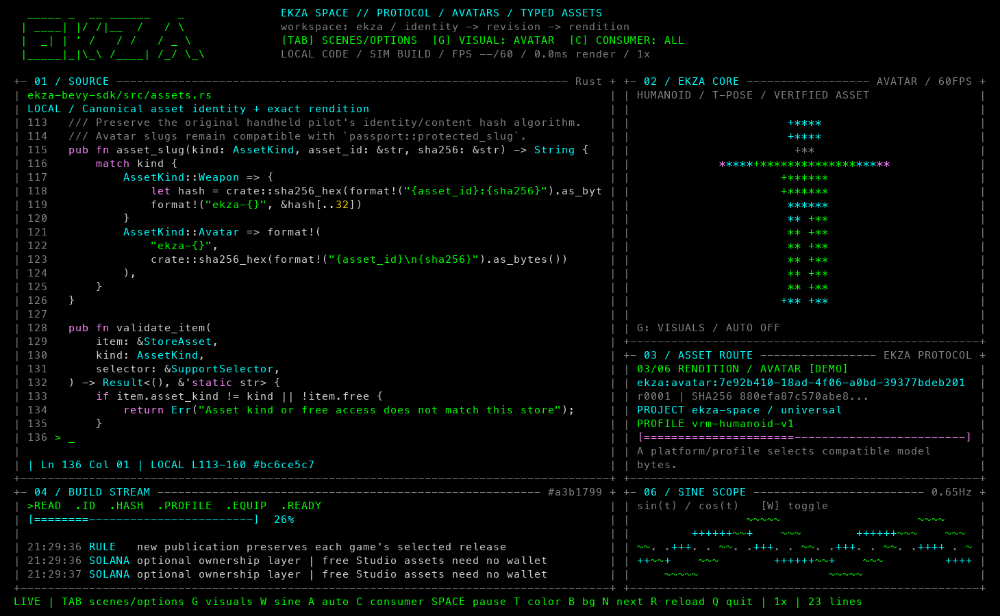
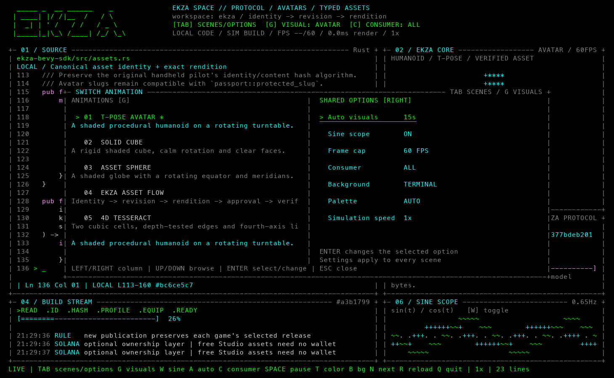
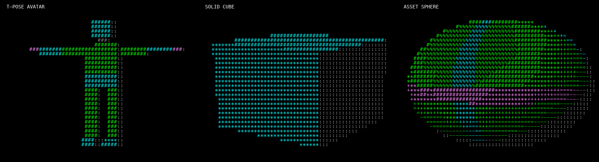

# DEV/OS

Проект следующей версии: [продуктовая и техническая спецификация](docs/evolution/README.md)
с семью новыми экранами, живыми сигналами, Agent Arena и
[интерактивным макетом](docs/evolution/screenbook.html).

Полноэкранный ASCII-имитатор разработки: настоящий код из репозиториев,
объяснение протокола Ekza, процедурная 3D-графика и синусоида. По умолчанию
отрисовка нацелена на 60 FPS; лимит можно поднять до 120 FPS.



Python **3.9+**, macOS или Linux с `curses`. Дополнительные Python-пакеты
не нужны. По умолчанию код показывается как текст, включая настоящие исходники
Ekza и OMOBA: симуляция ничего не компилирует, не запускает показанные инструкции,
не читает настоящие регистры или память, не подключается к сети и не записывает
данные на диск. Отдельно можно открыть **настоящий терминал**: команды в нём
выполняются реально. Для этого дополнительного режима нужен установленный `tmux`.

## Запуск

Из папки проекта:

```bash
python3 -m devos
```

Или из любой папки:

```bash
python3 /Users/wotori/git/dev-os/dev_show.py
```

Разверните окно терминала. При **120×36** и больше появляются все дополнительные
панели; на небольшом экране интерфейс автоматически упрощается. По умолчанию фон
наследуется от терминала, графика и рамки состоят из ASCII-символов.

## Настоящий терминал и Codex

**F2** открывает оболочку вместо `SOURCE` и передаёт ей клавиатуру. Введите
`codex` и нажмите Enter — его интерфейс появится в этой панели, а графика справа
продолжит работать. Codex должен быть установлен и доступен в `PATH`.
На Mac для функциональной клавиши может понадобиться **Fn+F2**.

- **F2** или **Ctrl+]** переключают ввод между терминалом и панелью управления.
- При фокусе в терминале `Tab`, стрелки, `Q` и остальные буквы получает дочерняя
  программа; **Ctrl+C** прерывает её, сохраняя DEV/OS.
- Вернувшись к управлению, нажмите **G** для смены графики или **Tab** для сцены.
- **F3** переключает отображение между терминалом и исходниками. Оболочка и
  запущенные в ней программы продолжают работать в фоне.
- После завершения дочерней программы **F2** запускает её заново.
- Выход из DEV/OS завершает его встроенный терминал. Для выхода нажмите
  **Ctrl+]**, затем **Q**.

Сразу открыть оболочку или Codex:

```bash
python3 -m devos --terminal --animation reactor --fps 120
python3 -m devos --command codex --cwd /Users/wotori/git/dev-os --animation reactor
```


Без `--cwd` используется папка, из которой запущен DEV/OS. `--command`
разбирается на аргументы без подстановок оболочки; для конвейера можно явно
запустить `--command "sh -lc 'ваша команда'"`. Настройки и авторизацию Codex
DEV/OS не меняет.

Используется отдельный временный сервер `tmux`: существующие сессии и
`~/.tmux.conf` не затрагиваются. tmux обрабатывает настоящий PTY, перемещения
курсора, прокрутку, альтернативный экран и размер окна. Снимки терминала
обновляются до 30 раз в секунду в отдельном потоке; графика сохраняет свой лимит
FPS. Цвета текста передаются в curses, фон сохраняется родным; инвертированные
выделения отображаются подчёркиванием. Мышь, графические протоколы терминалов и
OSC-ссылки/clipboard не передаются. Ширина составных emoji может отличаться от
нативного терминала. Для Codex и обычной оболочки проверено клавиатурное управление.

Без tmux симулятор работает как раньше; попытка открыть оболочку покажет
сообщение о недостающей программе. Никакие пакеты автоматически не устанавливаются.

## Фон

Программа сохраняет родной фон терминала, включая абсолютный чёрный и настройки
прозрачности. Цветовые палитры меняют только текст и графику. В меню выбранный
режим обозначается маркером и подчёркиванием без цветной подложки.

```bash
# Сохранить фон терминала — это поведение по умолчанию.
python3 -m devos --background terminal

# Явно задать чёрный фон внутри приложения.
python3 -m devos --background black
```

Клавиша **B** переключает эти два варианта, сохраняя выбор при смене сцен и палитр.
В 256-цветном режиме принудительный чёрный использует цвет 16 (`#000000`)
вместо зависящего от темы терминала цвета 0. В базовом цветовом режиме используется
обычный чёрный; если терминал не поддерживает наследование фона, он тоже служит
резервным вариантом.

## Сцены, анимации и общие настройки

**Tab** открывает выбор сцены с кодом, **G** — выбор анимации. В левой колонке
выбирается сцена или графика, в правой находятся общие настройки.
**← / →** переключают колонку, **↑ / ↓** или **J / K** выбирают строку,
**Enter** применяет выбор или меняет значение опции. **Esc** закрывает меню.
При открытом меню всё стоит на паузе. В узком окне показывается активная колонка.

Автосмена, синусоида, FPS, потребитель протокола, фон, палитра и скорость общие
для всех сцен. Выбранная через G анимация также сохраняется при смене сцены.
Печать кода и состояние его сборки при выборе графики не сбрасываются.



| Режим | Что на экране |
| --- | --- |
| **EKZA SPACE** — по умолчанию | Настоящие фрагменты Rust и TypeScript; общий протокол аватаров и ассетов. По умолчанию вращается персонаж в T-позе, рядом объясняется жизненный цикл ассета. |
| **BARE METAL** | C и x86-64 NASM: MMU, таблицы страниц, NVMe, переключение контекста. Тессеракт, регистры CPU, опкоды, дамп памяти и сборка ELF64. Палитра раскалённого металла. |
| **DEV LAB** | Python, Rust, TypeScript и Go. Прежний набор кода, вращающийся куб, графики и зелёные тесты. |
| **HYPERSPACE** | Геометрия на C, шейдеры GLSL и Rust. 4D-тессеракт, осциллограмма и конвейер проекции. |

Через **G** доступны шесть независимых визуализаций:



| Анимация | Содержание |
| --- | --- |
| **T-POSE AVATAR** | Процедурный персонаж с головой, корпусом, руками и ногами; вращение, освещение, проверка глубины |
| **SOLID CUBE** | Обычный жёсткий куб с затенёнными гранями |
| **ASSET SPHERE** | Затенённая сфера с вращающимся экватором и меридианами |
| **EKZA ASSET FLOW** | Пакет проходит по стадиям Identity → Revision → Rendition → Approval → Verify → Consumer |
| **4D TESSERACT** | Перспективная проекция вращающегося четырёхмерного куба |
| **PLASMA REACTOR** | Объёмное плазменное ядро, наклонённые 3D-орбиты и светящиеся частицы со шлейфами |

Куб, сфера и персонаж строятся математически, без загрузки моделей или 3D-пакетов.
Треугольники растеризуются в ASCII с освещением и буфером глубины.
**A** переключает автоматическую смену графики: выкл. / 8 / 15 / 30 секунд.
Ручной выбор анимации обнуляет таймер; пауза и открытое меню его останавливают.
**W** включает или убирает нижнюю панель `SINE SCOPE`: две синусоидальные кривые.
В окне уже 80 символов дополнительная панель автоматически скрывается.

```bash
python3 -m devos --animation avatar --fps 60
python3 -m devos --animation sphere --fps 120 --auto-cycle 15
python3 -m devos --animation reactor --fps 120
python3 -m devos --animation cube --no-scope
```

[](docs/screenshots/reactor.png)

У реактора вращаются орбиты и движутся частицы; затенённое ядро придаёт сцене
объём. Его можно выбрать через **G** в любой сцене, в том числе с C и ассемблером.
Реактор участвует в автоматической смене анимаций и использует общую палитру,
сохраняя фон терминала.

В шапке показываются измеренные FPS, целевой лимит и среднее время отрисовки.
Достижимая частота зависит от терминала и размера окна; `--fps` задаёт лимит.
Локальная проверка в псевдотерминале 144×44 на Python 3.9: аватар — 60.0 FPS,
сфера — 59.8 FPS при лимите 60 и 120.0 FPS при лимите 120; отрисовка сферы
занимала около 4.4 мс. Реактор при лимите 120 достиг 120.0 FPS,
средняя отрисовка — около 4.6 мс. Цикл кадров компенсирует опоздания системного таймера.

Тессеракт — настоящая математическая проекция: 16 вершин, 32 ребра, вращения
в плоскостях XW, ZW и XY, перспективные преобразования 4D → 3D → 2D.
Начальный вид — куб внутри куба. Две противоположные кубические ячейки и восемь
соединений по W различаются цветом; легенда находится под графикой.
Вращение замедляется около таких читаемых видов. Буфер глубины оставляет на
пересечениях ближнее ребро, дальние рёбра приглушены. Графика занимает большую
часть своей панели и подстраивается под её размер без обрезки вершин.

## Анимированное объяснение протокола

Протокол описывается как общий контракт Ekza, а потребители задаются отдельно.
Каждая стадия длится 3.5 секунды и показывает свой смысл:

1. **Identity:** постоянный `ekza:avatar:<uuid>` или `ekza:weapon:<uuid>`.
2. **Revision:** неизменяемая ревизия исходника и отдельная публикация.
3. **Rendition:** точные байты под платформу и профиль.
4. **Approval:** независимое одобрение версии потребителем.
5. **Verify:** проверка размера, SHA-256 и профиля в SDK.
6. **Consumer:** приложение само решает допуск, каждый участник проверяет свой файл.

Параметр **Consumer** в правой колонке или клавиша **C** переключает примеры:
`all`, `space`, `mirror`, `omoba`. В режиме `all` чередуются аватары Space,
Mirror и OMOBA и пример оружия. Space использует `universal / vrm-humanoid-v1`,
Mirror — `ios / arkit-body-v1`, OMOBA — `desktop / humanoid-glb-v1` и
`handheld-glb-v1`. Для Space и Mirror не изображается несуществующая поддержка
оружия: пример оружия использует потребителя с соответствующим профилем.

```bash
python3 -m devos --animation protocol --consumer all
python3 -m devos --animation avatar --consumer mirror
```

Демонстрационные ID/ревизии/хэши помечены `DEMO`. Это объяснение контракта,
а не обращение к реальному каталогу или сообщение о результате сетевой проверки.
Исходники в левой панели по-прежнему могут быть настоящими, с пометкой `LOCAL`.

## Код из настоящих репозиториев

При обычном запуске первый режим ищет соседнюю папку `ekza` и читает выбранные
фрагменты из пяти репозиториев: `ekza-bevy-sdk`, `ekza-stellar-sdk`, `omoba-bevy`,
`core` и `solana-ekza-space`. На экране видны путь файла, настоящие номера строк,
диапазон фрагмента, его SHA-256 и пометка **LOCAL**. При каждом новом выборе
фрагмента файл читается заново; `R` перечитывает текущий, `N` выбирает следующий.
Само изменение исходника не перезапускает печать автоматически.

```bash
python3 -m devos --ekza-root /Users/wotori/git/ekza
```

Если локального файла или нужной функции нет, включается встроенный **SNAPSHOT** —
выдержка из той же реальной репы. Можно принудительно показывать снимки:

```bash
python3 -m devos --bundled
```

Читаются только восемь явно заданных файлов, без рекурсивного обхода. Перечень
фрагментов, диапазоны снимков и источники архитектуры: [docs/ekza-sources.md](docs/ekza-sources.md).
Логи сборки и проверки остаются симуляцией: чтение исходников не запускает игры,
сетевые запросы, сборщики или инструкции из этих файлов.

## Управление

Эти сочетания управляют DEV/OS, когда клавиатура не передана дочернему терминалу.
**F2**, **F3** и **Ctrl+]** доступны в обоих режимах ввода.

| Клавиша | Действие |
| --- | --- |
| `Tab` | Открыть меню режимов / следующий пункт |
| `G` | Открыть меню анимаций / следующий пункт |
| `←` / `→` | Выбирать левую колонку или общие настройки |
| `↑` / `↓`, `K` / `J`, `Shift+Tab` | Выбирать режим в меню |
| `Enter` | Выбрать сцену/анимацию или изменить опцию |
| `Esc` | Закрыть меню; вне меню — выйти |
| `Пробел` | Пауза / продолжить |
| `+` / `-` | Скорость от 0.25× до 8× |
| `T` | Следующая цветовая палитра |
| `B` | Родной фон терминала / принудительный чёрный |
| `A` | Автосмена анимаций: выкл. / 8 / 15 / 30 секунд |
| `W` | Показать/скрыть синусоиду |
| `C` | Следующий потребитель протокола |
| `N` | Следующий файл текущего режима |
| `R` | Перечитать текущий исходник и начать его печать заново |
| `F2`, `Ctrl+]` | Открыть терминал / переключить фокус ввода |
| `F3` | Показать исходники / терминал, сохраняя дочернюю программу |
| `Q`, `Ctrl+C` | Выход с восстановлением терминала |

```bash
python3 -m devos --list-modes
python3 -m devos --mode ekza --speed 1.5
python3 -m devos --mode bare-metal --speed 1.5
python3 -m devos --mode hyperspace --theme matrix
python3 -m devos --mode lab --fps 20
python3 -m devos --duration 30 --seed 42
```

Палитры: `ember`, `neon`, `matrix`, `ice`, `amber`.
`--theme` и `T` выбирают общую палитру. Значение `AUTO` в правой колонке
возвращает начальную палитру каждой сцены.
`--duration` считает реальное время, включая паузы. По умолчанию симуляция работает
до выхода пользователя. Запускать нужно в интерактивном терминале.

При желании можно установить команду `devos` в своё виртуальное окружение:

```bash
python3 -m pip install -e .
devos --mode bare-metal
```

## Архитектура

```text
devos/
  cli.py           аргументы, проверка окружения, восстановление терминала
  app.py           горячие клавиши и цикл кадров
  session.py       две колонки меню, общие опции, автосмена, состояние сцен
  domain.py        неизменяемые описания режимов, исходников и логов
  modes.py         каталог режимов и загрузка текстовых ресурсов
  ekza.py          контекст Ekza/OMOBA и явный список исходников
  protocol.py      общий жизненный цикл, профили потребителей, демо-состояние
  sources.py       чтение локальных фрагментов, provenance и снимки
  simulation.py    печать кода, стадии сборки, логи и телеметрия
  machine.py       синтетические регистры, память и поток инструкций
  graphics.py      чистая математика куба, тессеракта и осциллограммы
  surfaces.py      процедурные сетки, свет, ASCII-растеризатор треугольников
  reactor.py       плазменное ядро, 3D-орбиты и шлейфы частиц
  visuals.py       каталог анимаций, движение пакета протокола, синусоида
  syntax.py        подсветка языков, NASM-регистров и инструкций
  layout.py        расчёт панелей под размер терминала
  renderer.py      панели интерфейса и меню выбора режима
  terminal.py      curses-адаптер, цвета и обрезка текста по границам
  shell.py         приватный tmux/PTY, ввод, снимки терминала и фоновые обновления
  snippets/        исходники-декорации, хранящиеся как .txt
tests/             unittest: состояние, геометрия, отрисовка и настоящий PTY
```

Симуляция не зависит от curses. Провайдер исходников передаётся ей отдельно;
рендерер только читает готовое состояние.
Новому режиму достаточно добавить `Mode` в `modes.py` и исходники в `snippets/`;
панели и управление общие. Симуляция не требует runtime-пакетов;
для дополнительного встроенного терминала используется внешняя команда `tmux`.

## Проверка

```bash
python3 -m unittest discover -s tests -v
```

Тесты проверяют переключения и сохранение состояния, паузу, циклы сборок,
математику 4D и 3D, глубину пересечений, общие опции, автосмену, стадии протокола,
профили потребителей, сохранение фона при смене палитр и сцен,
границы панелей, подсветку C/NASM, чтение реальных файлов,
перечитывание, fallback на снимки и работу в псевдотерминале:
Tab/G, обе колонки, стрелки, Enter, R, изменение размера, выход и Ctrl+C.
При наличии tmux также проверяются выполнение команд, UTF-8, рабочая папка,
изменение размера дочернего PTY, альтернативный экран, цвета, переключение фокуса,
передача Ctrl+C и удаление собственного сервера. PTY-тесты предназначены
для macOS/Linux.

Пока хранится только состояние текущего запуска: настройки и прогресс
между запусками не сохраняются. Windows без curses не поддерживается.
