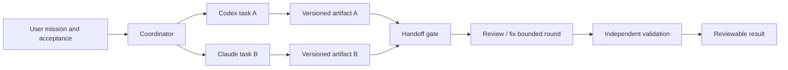

# Agent Arena: Claude + Codex

Статус: спецификация. Сейчас DEV/OS встраивает один настоящий терминал.
Два терминала, межагентные передачи и coordinator ниже ещё не реализованы.
Проверка официальных интерфейсов: 31 октября 2026. Протокол DEV/OS в этом
документе — предлагаемый собственный дизайн.

## 1. Что делает Arena интересной

Пользователь видит два независимых процесса работы и понятный результат их
встречи. Один строит, другой ищет слабые места; или оба решают разные части
одной задачи. Передача выглядит пакетом между двумя ядрами, но внутри пакета
лежат конкретный вопрос, артефакт и критерии проверки.

Три готовых сценария:

| Сценарий | Параллельная часть | Точка встречи | Результат |
| --- | --- | --- | --- |
| **Builder + Challenger** | Codex реализует, Claude составляет пограничные случаи по исходной спецификации | Challenger проверяет точный патч, builder исправляет замечания | Патч, проверка, список оставшихся вопросов |
| **Split Mission** | Два независимых подзадания в разных worktrees | Явная интеграция определённых артефактов и повтор тестов | Один обозримый кандидат результата |
| **Design Rally** | Оба предлагают решение с разными ограничениями | Обмен короткими предложениями и один раунд критики | Decision record с аргументами, без автоматических правок |

Роли можно менять местами; название вендора не определяет роль. В первом
сценарии оба агента могут быть заняты одновременно, но ревью конкретного
готового патча начинается после его создания. Это отражается на timeline.

## 2. Три уровня продукта

| Режим | Реальные процессы | Кто отправляет сообщения | Что видит пользователь |
| --- | --- | --- | --- |
| **Demo** | Не нужны | Конечный локальный сценарий | Зрелищный дуэт с явной меткой DEMO |
| **Watch** | Два интерактивных CLI через PTY | Человек в выбранном терминале | Два терминала, события сессий, фокус |
| **Relay** | Два managed adapters | Человек выбирает/редактирует готовое сообщение | Структурированный разговор и артефакты |
| **Mission** | Два managed adapters | Coordinator по ограниченному сценарию | Задания, действия, handoff, лимиты и итог |

Две работающие CLI-панели не означают автоматически наличие relay. Managed
adapter использует машиночитаемый интерфейс, а terminal capture остаётся
представлением для человека. Не ищем конец хода по тексту prompt, ANSI-кадру
или моменту исчезновения spinner.

## 3. Подтверждённые интерфейсы

### Codex

`codex exec --json` выдаёт JSONL событий; продолжение возможно через
`codex exec resume <SESSION_ID>`. Режим переиспользует сохранённую CLI-авторизацию
по умолчанию. Это подходящий простой адаптер для завершённых заданий.
[OpenAI: Non-interactive mode](https://learn.chatgpt.com/docs/non-interactive-mode).

Для постоянной managed-сессии выбрать Codex app-server по stdio: handshake
`initialize`/`initialized`, затем `thread/start` или `thread/resume`, `turn/start`,
stream notifications, финальный `turn/completed`. `turn/interrupt` запрашивает
отмену; сервер также предоставляет запросы approval. Фактические статусы и
возможности проверяются по используемой версии, experimental API сначала выключен.
[OpenAI: Codex App Server](https://learn.chatgpt.com/docs/app-server).

### Claude

CLI предоставляет `-p`, поток `--output-format stream-json` с `--verbose` и
`--include-partial-messages`; есть `--input-format stream-json` и
`--resume <session-id>`. Сохраняются отдельные ID каждой сессии. `--tools`
задаёт доступные built-in tools, тогда как `--allowedTools` лишь автоодобряет
вызовы и не ограничивает весь инструментарий.
[Claude CLI reference](https://code.claude.com/docs/en/cli-reference).

CLI-режим подходит для первых завершённых ходов с чтением NDJSON. Спецификация
не выдумывает внутренний raw control-message формат отмены Claude. У Python SDK
есть `ClaudeSDKClient.interrupt()`; после отмены надо завершить чтение результата
прежнего хода, прежде чем начинать следующий.
[Claude Python SDK](https://code.claude.com/docs/en/agent-sdk/python).

SDK требует Python 3.10+, поэтому для нынешнего ядра 3.9 это будущий
опциональный worker с собственным окружением, а не обязательный импорт.
[SDK quickstart](https://code.claude.com/docs/en/agent-sdk/quickstart).

### Возможности и доступ

Adapter сообщает `can_stream`, `can_resume`, `can_cancel`, `can_request_approval`,
`can_report_usage`, `can_report_cost`. Если штатной отмены нет, поддерживается
отдельная операция остановки собственного процесса с таймаутом; UI не выдаёт
её за подтверждённое завершение удалённой работы.

Для распространяемого SDK-продукта Anthropic отдельно ограничивает предложение
входа через claude.ai/его лимитов без предварительного разрешения; документация
направляет к API-key authentication. Поэтому «открыть установленный пользователем
CLI» и «продавать managed SDK-интеграцию» — отдельные продуктовые возможности.
Подписку нельзя автоматически обещать как доступ для любой интеграции.
[Agent SDK overview](https://code.claude.com/docs/en/agent-sdk/overview).

Headless Claude может загружать настройки, hooks и MCP проекта. Не включать
`--bare` незаметно: он меняет окружение и путь авторизации.
[Programmatic Claude](https://code.claude.com/docs/en/headless).

Минимальные версии не угадываются заранее. Перед запуском managed-миссии
проверяются установленные CLI, нужные флаги/handshake, доступ и выбранная
политика инструментов. Неудачная проверка оставляет доступными Demo/Watch.

## 4. Модель выполнения

`Mission` владеет task graph. Внутри есть `Task` для каждого агента и явные
зависимости: два задания могут быть `RUNNING`, если не ждут один и тот же артефакт.
На одну provider session одновременно приходится максимум один активный ход.

Управление остаётся локальным и однопроцессным в ядре. Каждый адаптер — worker
или отдельный subprocess. stdout протокола и stderr диагностики читаются
независимо, чтобы большой stderr не заблокировал stdout/процесс.

### Состояния

Mission: `DRAFT → READY → RUNNING → VALIDATING → READY_FOR_USER`.
Дополнительные состояния: `PAUSING`, `PAUSED`, `NEEDS_USER`, `FAILED`, `CANCELLED`.
`COMPLETED` назначается после принятия результата или явно заданного критерия
автозавершения. Deploy/merge не являются побочным эффектом этого состояния.

Task: `QUEUED → STARTING → RUNNING → SUCCEEDED | FAILED | CANCELLED`.
Ожидание approval и артефакта представлены `WAITING_FOR_USER` и `WAITING_FOR_PEER`.
Отмена имеет промежуточное `CANCELLING`: запрос отмены ещё не значит, что ход окончен.

`Pause mission` прекращает выдачу новых задач; текущие ходы завершаются по
выбранной политике pause или получают запрос отмены. UI явно показывает разницу.
`Stop mission` немедленно запрещает новые отправки, запрашивает отмену текущих
и через deadline завершает собственные worker-процессы, если это необходимо.

## 5. Собственный handoff-протокол

Пример — в [handoff.example.json](examples/handoff.example.json), схема —
[handoff.schema.json](examples/handoff.schema.json).

Обязательные поля: версия, mission/task ID, message ID, parent/reply ID,
sender/recipient, порядковый номер, тип, краткое содержание, ссылки на
артефакты и ожидаемый результат. Виды сообщений:

`proposal`, `review_request`, `changes_requested`, `approved`, `question`, `done`, `blocked`.

Передача допускается только для завершённого публичного ответа/структурированного
итога. Токеновые дельты используются для отображения и не запускают второго агента.
Скрытое рассуждение не является необходимым контрактом и не реконструируется UI.

Coordinator, а не агент, назначает получателя по task graph, лимит, cwd, роль
и разрешённые действия. Текст «попроси второго агента выполнить команду» не
обходит эти настройки. Agent output — входные данные и предложение, не новый
источник полномочий.

Каждая доставка привязана к message ID и sequence. UI хранит состояния
`draft/ready/sending/delivered/replied/rejected`. Дубликат финального события
или reconnect не создаёт новый ход. Если отправка потеряла ответ, состояние
становится `DELIVERY_UNKNOWN`: нельзя вслепую повторить запрос, который мог
уже запустить работу. Сначала сверяются session/turn ID и журнал; иначе `NEEDS_USER`.

Malformed JSON не отправляется другому агенту. Пользователь видит исходный
ограниченный текст и причину; schema-repair, если появится, считается отдельным
ходом с теми же лимитами.

## 6. Ограниченный обмен вместо бесконечного цикла

Стартовый mission preset:

| Ограничение | Предложение |
| --- | --- |
| Участников | 2 |
| Активных ходов на session | 1 |
| Доставленных handoff на миссию | Не больше 6 |
| Fix/review циклов | Не больше 2 |
| Wall-clock deadline | 15 минут, редактируется до запуска |
| Размер одного handoff | До 16 KiB текста + ссылки на артефакты |
| Prompt/context | Summary и выбранные файлы/дифф, не весь разговор обоих агентов |
| Retries | Только явно безопасные ошибки до запуска; максимум 1 |

Повтор того же artifact hash и того же review verdict без новых изменений
останавливает цикл как `NO_PROGRESS`, с финальной сводкой. Достижение лимита
даёт понятный частичный результат и `NEEDS_USER`, не автоматическое продление.
Подтверждение одного агента без реальной проверки не закрывает тестовые критерии.

Бюджет считает coordinator на всю mission. Claude `--max-turns` и
`--max-budget-usd` не заменяют этот учёт: первый ограничивает запрос, второй
использует estimate и допускает превышение; расходы прежних resumed-запусков
в него не входят. Число в UI — оценка, не подтверждённый счёт.
[Claude CLI limits](https://code.claude.com/docs/en/cli-reference).

Если стоимость неизвестна, автоматический режим требует лимит по времени и
числу handoff. Точный жёсткий долларовый предел без соответствующего механизма
поставщика не обещается; coordinator прекращает новые ходы заранее, оставляя запас.

## 7. Файлы, параллельность и проверка

Базовый вариант — отдельные worktrees с общим исходным commit и явным владельцем
каждой задачи. Git worktree изолирует рабочие файлы, но **не является sandbox**:
права инструментов и ОС настраиваются отдельно.

Worktree-сценарий требует существующего base commit. Если проект ещё без
первого commit, реализация должна обнаруживать это заранее и предлагать
Watch/Design Rally или snapshot-режим.
Создавать начальный commit автоматически ради запуска миссии не следует.

Для Builder + Challenger reviewer получает неизменяемый snapshot/patch с
base hash, artifact hash и manifest файлов. Для Split Mission результаты
интегрируются в отдельном integration workspace. Пересекающиеся правки дают
`NEEDS_USER` или отдельную явно разрешённую задачу разрешения конфликта.
Исходная грязная рабочая папка пользователя не сбрасывается и не используется
как общая точка записи двух независимых агентов.

Роль reviewer обеспечивается фактическим набором инструментов/правами, а не
словом «read-only» в prompt. В Claude SDK deny rules и набор tools важны:
callback `canUseTool` не вызывается для уже автоодобренных действий.
[Claude permissions](https://code.claude.com/docs/en/agent-sdk/permissions).

Артефакты: patch, snapshot manifest, test report, decision note. У каждого
есть ID, content hash, producer, base и относительные пути. Path traversal,
symlink escape и произвольные file-URL из ответа не читаются как доверенные
артефакты. Бинарные файлы передаются ссылкой/описанием в разрешённом каталоге.

Validation runner запускает заранее выбранные проверки на конкретном artifact
или integration revision. В отчёте есть argv, cwd, revision/hash, время, exit
code и доступная parsed summary. Сообщение агента «tests passed» отображается
как его утверждение, пока нет соответствующего результата runner.

## 8. Владелец ввода и ручное вмешательство

У session единственный owner: `human` или `coordinator`. В режиме Watch — human.
В Mission — coordinator; перейти в ручной режим можно только после остановки
выдачи/завершения текущего managed-хода. Managed UI — собственная лента событий,
не обязательно тот же TUI-процесс, который открыт во втором представлении.

Запрос approval/вопрос появляется отдельной карточкой и не нажимает ничего
в терминале. Неодобренное действие остаётся ожидающим или отклонённым согласно
политике поставщика; агент-сосед не отвечает вместо пользователя на разрешения.
Обычные уже разрешённые действия выполняются без добавления лишнего диалога DEV/OS.

## 9. Журнал и product UX

Timeline показывает запуск, ожидание, передачу, проверку, отмену и выход.
Раздельны task duration, wait time и reported usage. `Thinking` без соответствующего
события провайдера не выдаётся за факт; достаточно `RUNNING`.

Пресеты общения задают длину handoff и роли: `Builder/Challenger`, `Split`,
`Design Rally`. Пользователь может редактировать следующее сообщение до отправки.
Кнопка «Отправить последнюю завершённую сводку» понятнее автоматического
копирования произвольного выделения экрана.

В replay сохраняется граф заданий и разрешённые категории сообщений. В Stream
View видны только роли, статусы и анимация пакетов, без содержимого промптов и cwd.

## 10. Приёмка

- Два настоящих CLI работают одновременно с независимыми вводом и размером.
- Два fake managed adapter выполняют parallel task graph без реальных API-вызовов.
- Доставка одного message ID происходит не больше одного раза; uncertain delivery
  не запускается повторно автоматически.
- Стрим токенов никогда не запускает peer; только завершённый валидный handoff.
- Лимиты, deadline, stop, cancellation acknowledgment, ошибки и `NO_PROGRESS`
  проверяются fake clocks/fixtures.
- Согласие агентов без пройденных критериев не даёт `READY_FOR_USER` как проверенный результат.
- Ни один адаптер не получает расширенные права из prompt другого агента.
- Отсутствие CLI/учётных данных не мешает Demo и не маскируется вымышленным LIVE.
