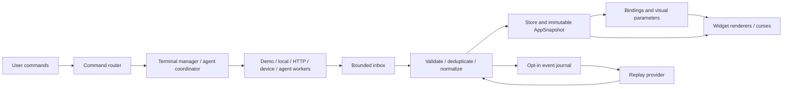

# Архитектура расширяемого DEV/OS

Статус: target design. Предлагается постепенная миграция текущего Python 3.9+
приложения с curses и стандартной библиотекой. Существующие CLI, рендереры
геометрии, провайдер исходников и tmux-терминал остаются рабочими на каждом шаге.

## 1. Границы понятий

| Понятие | Содержит | Пример |
| --- | --- | --- |
| Workspace | Проект, выбранные подключения, терминальные сессии, пресеты | `ekza-sdk` |
| Screen | Композицию панелей и правила выбора фокуса | `cockpit`, `arena` |
| Scene | Существующий контекст симуляции кода | `ekza`, `bare-metal` |
| Widget | Один прибор или интерактивную панель | terminal, visual, metric, event tape |
| Visual | Математику изображения и параметры | reactor, gravity-well |
| Provider | Получение конкретного внешнего или синтетического потока | HTTP JSON, Git, demo, BLE bridge |
| Binding | Типизированное преобразование сигнала в параметр/эффект | online → particle density |
| Preset | Сохранённую композицию этих частей | `night-shift`, `showcase` |

Существующий `Mode` остаётся сценой. `--mode ekza` сохраняет смысл; новые
`--screen` и `--preset` — будущие независимые параметры. `sources.py` по-прежнему
читает allowlisted код; телеметрия получает отдельный пакет `telemetry`.

## 2. Путь данных



Это внутрипроцессный набор объектов и очередей. Брокер сообщений, серверная
база, Web UI и отдельный сервис для каждого виджета на первом этапе не нужны.
SDK worker с другим Python или BLE bridge — опциональные процессы-адаптеры.

**Рендер не выполняет I/O, не запускает процессы, не изменяет состояние и не
продвигает время.** Он читает готовый snapshot. Внешние события не превращаются
в команды управления без явного перехода в соответствующем coordinator.

## 3. Минимальные контракты

Ниже эскиз Python API, не существующая реализация:

```python
from dataclasses import dataclass
from typing import Optional, Protocol, Sequence, Tuple

@dataclass(frozen=True)
class MetricSample:
    key: str
    value: Optional[float]       # None != 0
    unit: str
    source_id: str
    source_session_id: str       # новый запуск источника — новая сессия
    sequence: int
    observed_at: Optional[str]   # UTC, если известно время измерения
    received_monotonic: float    # только текущий процесс
    mode: str                   # demo | live | replay
    quality: str                # ok | stale | unavailable | error
    measurement_id: Optional[str] = None
    initial_age_seconds: Optional[float] = None
    time_basis: str = "received_only"
    origin_mode: Optional[str] = None

class Provider(Protocol):
    def poll(self, deadline: float) -> Sequence["DataEvent"]: ...
    def close(self) -> None: ...

class Widget(Protocol):
    def render(self, canvas, rect, snapshot: "AppSnapshot") -> None: ...

class Visual(Protocol):
    def render(self, viewport, visual_time: float, parameters: tuple): ...
```

`DataEvent.payload` после валидации преобразуется в один из неизменяемых типов:
`MetricSample`, `TaskResult`, `AgentMessage`, `SourceState`, `VisualCue`.
JSON-словари не передаются между потоками в качестве «frozen» объектов:
`frozen=True` не делает вложенный изменяемый `dict` неизменяемым.

`AppSnapshot` содержит tuples снимков панелей, метрик, терминалов, агентов,
последних событий и UI-состояния. Хранилище меняется на UI-потоке; snapshot
заменяется целиком/по изменённым ветвям. Входная строка терминала не копируется
целиком в каждый кадр, если её `revision` не изменился.

JSON-конверт событий — в [event.schema.json](examples/event.schema.json).
Он версионирует транспортный слой, а payload валидируется по topic.
Для неизвестного topic можно сохранить ограниченный диагностический факт;
выполнять его как действие нельзя.

### Регистрация

Сначала явные Python-реестры. Пример будущего descriptor:

```python
VisualSpec(
    id="gravity-well",
    title="GRAVITY WELL",
    caption="ACCRETION DISK / DEPTH / PARTICLES",
    renderer=render_gravity_well,
    minimum_size=(24, 8),
    parameters=GRAVITY_PARAMETERS,
    supported_events=("visual.cue",),
)
```

Одна запись содержит renderer, caption, описание, ограничения и параметры.
Аналогичные `ScreenSpec`, `WidgetSpec`, `ProviderSpec` содержат необходимые
фабрики и metadata. Никаких `eval`, произвольных import-путей из JSON или
автоматической загрузки стороннего Python из рабочего проекта.

## 4. Время, очереди и нагрузка

| Часы/поток | Предлагаемая частота | Пауза меню |
| --- | --- | --- |
| Отрисовка | 60 FPS, опционально 120 | UI продолжает рисоваться |
| Демо/декоративное движение | Покадрово, speed-scaled | Можно заморозить |
| Живые измерения | Частота поставщика | Продолжаются |
| Видимый терминал | До 30 снимков/с | Продолжается |
| Скрытый терминал | Около 2 снимков/с; процесс работает всегда | Продолжается |
| HTTP/Git | По настройкам адаптера, обычно секунды | Продолжается |
| Replay | Независимый playhead | Своё play/pause |

Текущий накопительный frame deadline в `app.py` сохраняется. Меню не ставит
на паузу физический датчик, сеть, CLI-процесс или возраст его данных.
`Freeze visual`, `Pause demo`, `Pause replay`, `Pause mission` — разные команды.

Начальные инженерные бюджеты, которые проверяются замерами:

- UI за кадр принимает не более 256 событий или 1.5 мс обработки, что наступит раньше.
- Для gauges хранится последнее значение на `(source_id, metric_key)`; счётчики
  и состояния задач требуют собственного порядка/агрегации, их нельзя слепо заменить.
- Очередь critical lifecycle/agent-событий ограничена, например 1024 событиями.
  Переполнение приостанавливает producer/миссию и поднимает `BACKPRESSURE` через
  отдельный health-state; молчаливой потери итогов хода нет.
- Лента в памяти ограничена 2000 событиями; детализация и архив имеют отдельные лимиты.
- Терминальный paste буфер ограничен, например 64 KiB. Превышение сообщается
  до принятия новой порции; байты не теряются незаметно. Очередь сейчас не ограничена —
  это отдельная миграционная задача.
- HTTP имеет timeout и backoff с jitter. Адаптер обязан соблюдать deadline;
  потенциально неограниченно блокирующие библиотеки живут в завершаемом worker-процессе.
- Виджеты за пределами viewport не растеризуются. Сетка/топология кешируются,
  история графиков прореживается под ширину панели.

120 FPS — опциональная измеряемая возможность. Базовая приёмка: стабильное
управление и 60 FPS на выбранном эталонном окружении с двумя видимыми терминалами.
В benchmark фиксируются размер, backend, число источников, ОС и версии.

## 5. Происхождение и качество данных

`mode` и `quality` — независимы. `LIVE + STALE` возможно; `DEMO + OK` тоже.
Метаданные на экране: источник, единица, окно агрегации, возраст, качество.

Для каждого provider задаются `interval`, `stale_after`, `unavailable_after`,
`timeout`. Возраст внутри процесса считается монотонными часами. Исходный UTC
нужен для provenance, но перевод системных часов не должен оживить старый образец.

Успешный HTTP-ответ обновляет transport health, а не обязательно свежесть
измерения. Повтор того же upstream measurement ID/`observed_at` не обнуляет
возраст sample. Если timestamp доверенный, при первом приёме вычисляется
`initial_age_seconds`, далее возраст = initial age + monotonic elapsed.
Новое измерение с тем же числом и новым timestamp считается новым образцом.
Новый poll/event ID сам по себе не является доказательством нового измерения.
Аномальное расхождение часов маркируется отдельным time-quality статусом.
Если известен только момент получения, UI пишет `received age / source age unknown`;
это проверка связи, а не обещание времени физического измерения.

Sequence сравнивается внутри `(source_id, source_session_id)`. Новый source
session позволяет перезапустить нумерацию; старые/дублирующиеся сообщения не
откатывают gauge и не запускают эффект второй раз. В recording сохраняются
UTC и относительный offset, не монотонное время прежнего процесса.

После stale-порога показывается последнее значение с возрастом. После hard TTL
значение текущей карточки становится `None`/`--`; история сохраняется.
Переход с LIVE в DEMO всегда явный, с новой меткой, не автоматический fallback.
Смешанный пульт показывает provenance на каждом виджете, а в шапке — `MIXED`.

Демо-сборки имеют topic `demo.build.finished`. Настоящий `task.test.completed`
создаётся runner/adapter после действительного завершения известной команды.
Если runner знает лишь exit code, он не придумывает количество тестов или coverage.

## 6. Binding engine

Binding содержит source/metric или event topic, целевой visual-параметр,
допустимые единицы, нормализацию, диапазон, сглаживание и missing policy.

Поддержать сначала только whitelist операций: linear, log1p, clamp, EMA,
порог с hysteresis и конечный event-trigger. Детали и примеры — в
[signals-and-visuals.md](signals-and-visuals.md).

Числовой виджет показывает измеренный образец, не сглаженную графическую
величину. Если одна точка означает пять сессий, это подписывается. Событие
провала не сглаживается до «почти успеха».

## 7. Несколько терминалов и управление агентами

`TerminalManager` владеет сессиями по ID: argv, cwd, собственные ресурсы tmux,
размер, видимость, владелец ввода и последний `TerminalFrame`.
В первом расширении можно сохранить один существующий `EmbeddedTerminal`
на слот. Объединение в один private server с независимыми окнами — отдельная
оптимизация после замеров, не предварительное условие двух панелей.

Слот терминала не принадлежит конкретному экрану: смена экрана не закрывает
процесс. Уничтожение workspace завершает только его управляемые ресурсы.
Возврат из скрытого состояния сначала применяет актуальный размер, затем фокус.

`AgentSession` — отдельная сущность с adapter capabilities и протокольным ID.
Интерактивный terminal slot и managed agent session могут быть разными процессами.
Нельзя обещать, что JSON-адаптер может автоматически «подхватить» любой уже
запущенный TUI. При ручной передаче управления coordinator сначала останавливает
отправку managed-входа. Один процесс имеет одного владельца ввода.

## 8. Пресеты, конфигурация и запись

Формат — JSON с `schema_version`; ядро Python 3.9 не требует TOML/YAML-пакета.
Порядок настроек: CLI → выбранный preset → user config → defaults.
Сохранение — во временный файл и атомарный rename. Неизвестные ID вызывают
понятную ошибку конфигурации с предложением доступных вариантов.

Пресет хранит известные IDs и значения параметров. Команды/ключи не выполняются
просто от открытия присланного preset или репозитория. Явный запуск через текущий
`--command` сохраняется; настройки продукта не обходят выбранные пользователем
политики CLI. Токены задаются ссылками на env/keychain адаптера, не значениями
в экспортируемом JSON. Экспорт workspace очищает локальные пути и персональные IDs.

Recorder включается явно. Формат JSONL/gzip: manifest с версией, seed, параметрами,
события с offsets, периодические checkpoints. Начальный лимит — 50 MiB на сессию,
понятная ротация и индикация записи. Терминальный текст, полные промпты и пульс
включаются отдельными категориями, не автоматически вместе с обычными событиями.

Replay создаёт runtime без живых исполнителей команд. Записанные `command`,
`handoff` и `approval` — данные для просмотра. Seek не вызывает side effects.
У replay sample `mode=replay`, исходное `origin_mode` сохраняется для подписи.
В JSON-конверте `origin_mode` обязателен для replay и равен `demo` или `live`;
при повторной записи replay сохраняется первоначальное происхождение.

## 9. Предлагаемые модули

```text
devos/
  runtime/       clocks.py, events.py, store.py, snapshot.py, lifecycle.py
  ui/            commands.py, focus.py, screen_registry.py, widget_registry.py
  screens/       cockpit.py, visual_lab.py, arena.py, site.py, body.py, atlas.py, replay.py
  widgets/       terminal.py, visual.py, metric.py, timeseries.py, event_tape.py, graph.py
  telemetry/     contract.py, scheduler.py, demo.py, json_stream.py, http_json.py, git.py
  bindings/      model.py, transforms.py, engine.py
  terminals/     manager.py                 # wraps current shell.py
  agents/        contract.py, coordinator.py, relay.py, artifacts.py, adapters/
  persistence/   config.py, presets.py, recorder.py, replay.py
  visual_catalog.py                          # descriptors around existing visuals
```

Это направления ответственности, не требование немедленно создать все файлы.
Папка появляется при первой реализации соответствующей возможности.

## 10. Миграция существующего кода

| Сейчас | Первый шаг | Последующий шаг |
| --- | --- | --- |
| `app.py` | Вынести TerminalManager, сохранить frame pacing | Runtime получает данные workers и создаёт snapshot |
| `session.py` | Разделить UI state и source/terminal snapshots | Reducer команд и экранов без I/O |
| `layout.py` | Обернуть нынешний `arrange` в Cockpit screen | Другие screen layouts + размерные приоритеты |
| `renderer.py` | Выделить widget methods без смены их вида | Render по ScreenSpec и snapshot |
| `visuals.py` | Собрать dispatch/caption/metadata в VisualSpec | Подключить typed parameters и bindings |
| `shell.py` | Сохранить реализацию, добавить bounded input/health | Несколько сессий, capture priorities |
| `domain.py` | Использовать frozen-подход для новых контрактов | Отдельные typed payloads |
| `sources.py` | Оставить allowlist/provenance чтения кода | Использовать как один source widget, не telemetry API |
| `protocol.py` | Сохранить demo lifecycle | Разделить fixture и manifest/catalog adapters |

Первые PR не переименовывают все модули одновременно. Старые launchers,
`--mode`, `G`, фон, F2/F3 и auto-cycle остаются совместимыми. Новые форматы
версионируются отдельно от CLI.

## 11. Проверка архитектуры

- Реальный frozen snapshot не меняется во время render; renderer не создаёт subprocess.
- Один зависший provider не блокирует клавиатуру, графику и другие источники.
- Статусы stale/error/unavailable и восстановление проверяются fake clocks.
- Перезапуск source session, дубликаты и переставленные сообщения не удваивают эффекты.
- Все screen layouts проверяются на пересечения и clipping при 48×16…240×60.
- Два терминала имеют независимые ввод, cwd, resize, exit и фокус; удаляются только свои ресурсы.
- Replay с одинаковой версией/seed воспроизводит значения и порядок cues, не вызывает команды.
- Fake adapters покрывают relay, cancel, timeout, malformed output, backpressure и лимиты.
- Нынешние 75 тестов остаются исходной регрессионной базой; новые тесты добавляются
  по реализованному поведению, а не копируют каждую строку предлагаемых интерфейсов.
