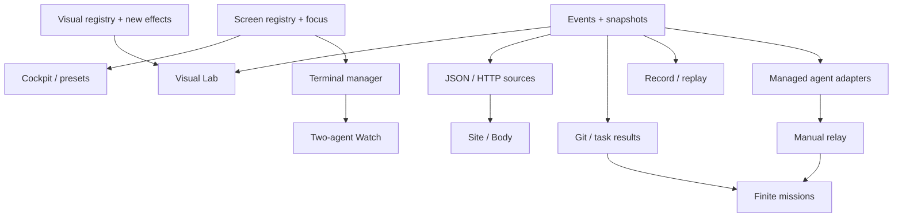

# План следующей эволюции

Статус: backlog по спецификации. Номера версий ниже предлагаемые.
Объём S/M/L — относительная сложность, не обещание календарного срока.

## Релиз 0.5 — Stagecraft: сначала ощутимый фан

Цель: продукт интересен без сайта, датчика и платных агентов. Красивые сцены
уже используют события и контракты, которые позднее примут настоящие данные.

| ID | Задача | Объём | Зависит от | Готово, когда |
| --- | --- | --- | --- | --- |
| S01 | VisualSpec вместо разрозненных registry/dispatch/caption | S | — | Новый визуал добавляется модулем и регистрацией |
| S02 | ScreenSpec + обёртка существующего Cockpit | M | — | Старый CLI и внешний вид работают, появились выбор экрана и zoom |
| S03 | Command palette и контекстная справка | S | S02 | Поиск находит экран, визуал, панель и команды; фокус терминала не теряется |
| S04 | JSON-пресеты, workspace seed, сохранение настроек | M | S01–02 | Экспорт/импорт воспроизводит вид без секретов и автозапуска команд |
| S05 | Event/Metric контракт, immutable snapshots, bounded inbox | M | — | Demo producer и fake-clock тесты качества/порядка работают |
| S06 | Visual Lab с готовыми bindings | M | S01, S05 | Можно подключить demo.online к частицам через UI |
| S07 | Gravity Well + Packet Garden | M | S01 | Два эффектных ASCII-режима с LOD, bounds и time-based motion |
| S08 | Arena-demo, Twin Core, 60-секундный сценарий | M | S02, S05 | Конечная история понятна без CLI и имеет явную метку DEMO |

**Рекомендуемые первые три PR:**

1. S01 + первый Gravity Well. Быстрый видимый результат и небольшой архитектурный шов.
2. S02 + S03 + основа S04. Настоящие композиции/управление и сохранённый пульт.
3. S05 + S06 + Arena-demo. Источники и события получают единую основу.

Packet Garden, второй пресет и полировка входят в завершение Stagecraft.
Первый релиз не требует реализации всех семи полноценных экранов: остальные
уже спроектированы и используют те же contracts.

Приёмка релиза: запуск без настроек, выбор эффектного пресета за минуту,
восстановление сохранённой композиции, честные source badges, 30 минут
работы в прежнем встроенном терминале без потери клавиатуры.

## Релиз 0.6 — Workspace: локальная работа и два CLI

| ID | Задача | Объём | Зависит от | Готово, когда |
| --- | --- | --- | --- | --- |
| W01 | TerminalManager, два независимых слота, bounded paste | M | S02 | Два CLI живут при смене экранов, ввод и resize независимы |
| W02 | Arena Watch + роли/раскладки | M | W01 | Пользователь запускает Codex и Claude рядом и выбирает owner ввода |
| W03 | Git provider + RepoVerse в Atlas | M | S05 | Реальный status/дерево, provenance, read-only diff |
| W04 | Task runner и test-result adapter | M | S05 | Exit code и результаты привязаны к конкретному запуску и revision |
| W05 | Recorder и Replay Studio | L | S05 | Запись нормализованных событий, seek/checkpoints, никаких live side effects |
| W06 | Stream View и Scene Capsule | S | S04, W05 | Показ друзьям не включает терминалы, пути и личные сигналы по умолчанию |

Модуль Git не пытается сразу анализировать зависимости всех языков.
Task runner принимает конкретную разрешённую команду; он не пытается угадывать
все успешные тесты из текста любого терминала.

Приёмка: два настоящих терминала, все resize/focus/exit-сценарии и replay без
установленных агентов. Замер 60 FPS в эталонной конфигурации с двумя панелями;
120 FPS публикуется только как результат конкретного benchmark.

## Релиз 0.7 — Signals: сайт и личный ритм

| ID | Задача | Объём | Зависит от | Готово, когда |
| --- | --- | --- | --- | --- |
| D01 | JSON file/stream provider | S | S05 | Внешняя утилита меняет метрики без изменения renderer |
| D02 | HTTP JSON provider, polling, TTL, backoff | M | D01 | Timeout/401/429/malformed response не блокируют UI |
| D03 | Site Observatory с агрегатной картой | M | S02, S06, D02 | Видны точные определения online/окна, масштабы точек и возраст |
| D04 | Первый сайт: mapping существующей аналитики/endpoint | M | D02–03 | Сверка с контрольным источником, исправное отключение и восстановление |
| D05 | Body Signal + BPM/RR JSON bridge | M | D01, S06 | BPM-only и RR различаются, потеря сигнала видна |
| D06 | BLE или phone bridge для конкретного устройства | L | D05 | Проверено с выбранным оборудованием; зависимости остаются optional |
| D07 | Event Director, intensity profiles | S | S06, W05 | В spectator mode работает красиво и не забирает терминальный фокус |

Выбор сайта/аналитики и устройства нужен перед D04/D06, не для начала Stagecraft.
Универсальные контракты можно реализовать и проверить без этих данных.

## Релиз 0.8 — Managed Duet: осмысленное сотрудничество

| ID | Задача | Объём | Зависит от | Готово, когда |
| --- | --- | --- | --- | --- |
| A01 | Agent/Task/Artifact contracts + fake adapters | M | S05, W05 | Два фейковых агента выполняют finite task graph детерминированно |
| A02 | Capability discovery и Codex adapter | M | A01 | Explicit session IDs, stream/final/cancel/approval нормализованы |
| A03 | Claude CLI adapter; optional SDK worker отдельно | M/L | A01 | NDJSON, resume и ограничения версии проверены |
| A04 | Ручной Relay: inspect/edit/send | M | A02–03 | Никакого ANSI scraping, дубликатов и слепых повторных запусков |
| A05 | Builder + Challenger, максимум два fix-review цикла | L | A04, W04 | Артефакты, лимиты, no-progress, stop, validation и итог работают |
| A06 | Split Mission в worktrees + integration workspace | L | A05 | Реальная параллельность без общей точки записи; конфликты видны |
| A07 | Итоговая сводка и Replay Arena | S | A05, W05 | Видно, что сделали, что проверили и что осталось человеку |

Managed integration зависит от интерфейсов и доступа конкретных CLI.
Watch не обязан ждать A01–07. SDK/авторизация для распространяемого продукта
проверяются отдельно по [agent-arena.md](agent-arena.md).

## Граф зависимостей

## Общие критерии готовности

- Нынешняя работающая версия и её 75 тестов сохраняют поведение после первых
  миграций; новые сценарии проверяются по мере появления.
- UI и pure renderer не делают I/O. Неисправный источник не блокирует ввод.
- Нет общего глобального LIVE, скрывающего смешанное происхождение панелей.
- Сигнал отсутствует → `--`; успешность неизвестна → `unknown`, не зелёный success.
- Конфигурация импортируется без выполнения кода; очереди/история ограничены.
- Отсутствующий tmux/CLI/датчик не мешает офлайн-сценарию.
- Replay никогда не вызывает live-исполнители; ручной ввод и coordinator
  не управляют одной session одновременно.
- Изменения параметров, источников и фокуса переживают resize и переключение экрана.

## Что сознательно отложено

Автоматический публичный marketplace плагинов, собственная облачная учётная
система, универсальная автономная команда агентов, медицинская интерпретация,
полная IDE/LSP, синхронизация workspace между устройствами, GPU-рендер и
автоматическая публикация/деплой. Для первого продукта это отдельные направления,
которые увеличили бы сложность до проверки основной идеи.

## Решения перед конкретными live-задачами

1. Для сайта: домен, существующая аналитика/backend, смысл online и разрешённые агрегаты.
2. Для пульса: устройство, доступный протокол и приемлемый способ bridge.
3. Для managed Arena: версии CLI, способ доступа, выбранные роли/инструменты,
   бюджет и способ изоляции конкретного workspace.

Эти неизвестные отмечены как входные данные будущих задач. Дизайн и первый
релиз не требуют угадывать их или сейчас менять другие репозитории.
