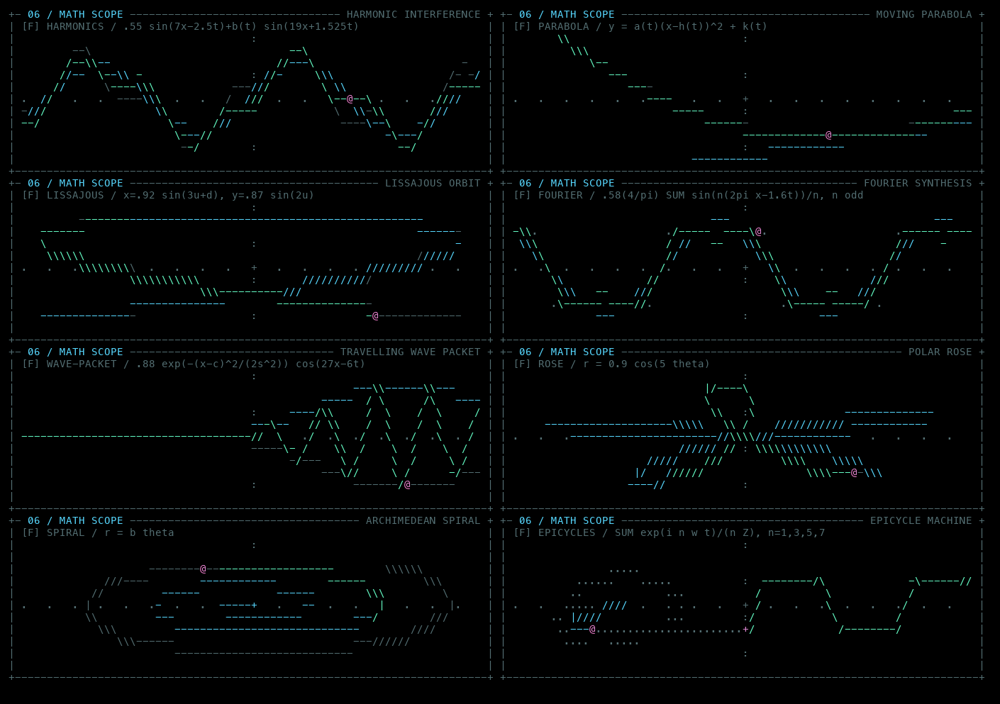
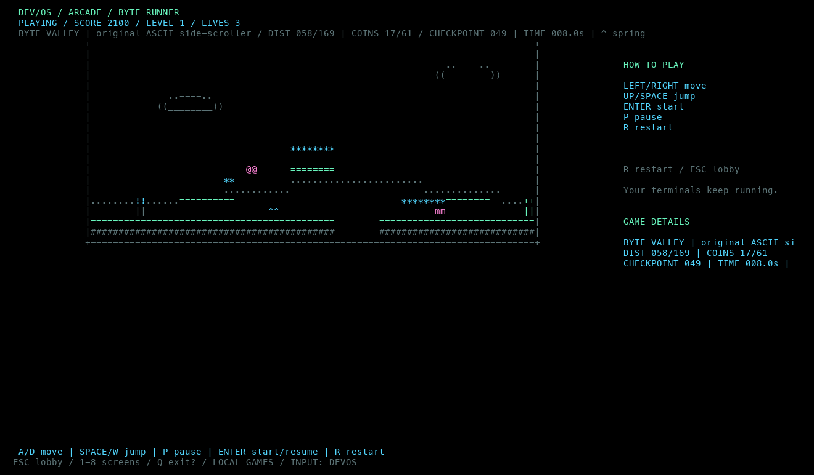
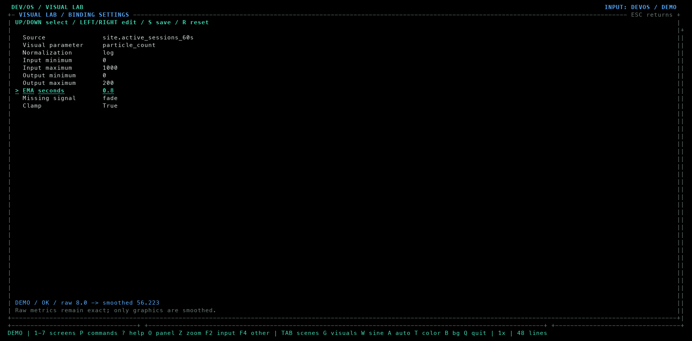
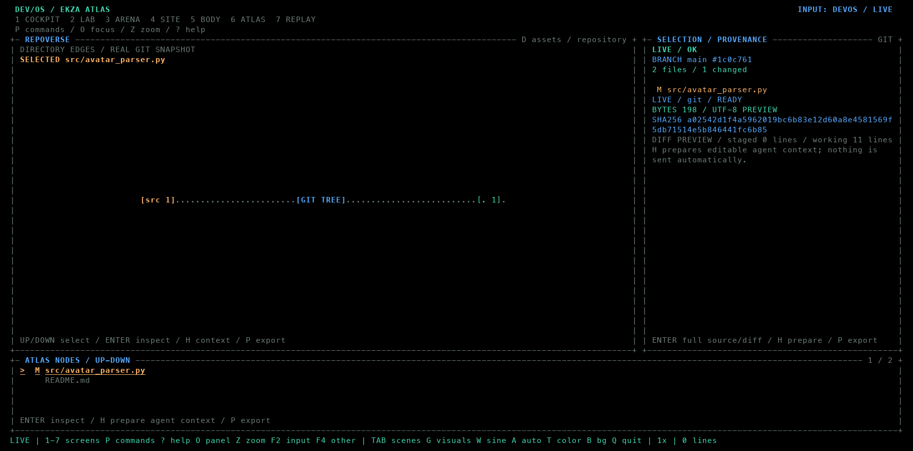
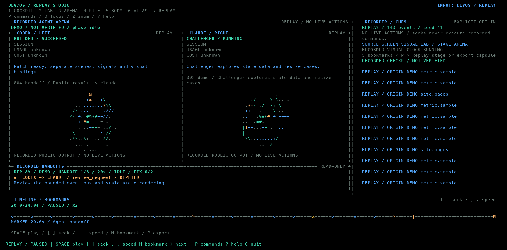

# DEV/OS Workbench

Workbench связывает терминал, графику, проверяемые локальные данные и повтор
рабочей сессии. Для знакомства не нужны модели, сайт или датчик:

```bash
cd /Users/wotori/git/dev-os
python3 dev_show.py --no-config --bundled --preset showcase
```

`1`…`8` переключают экраны, `P` открывает поиск команд, `?` — справку.
Все сочетания ниже работают при вводе в DEV/OS. В дочернем терминале буквы,
стрелки и Enter принадлежат запущенной программе; `F2` или `Ctrl+]` возвращают
управление пульту.

`Q`, `Ctrl+C` на пульте и Esc вне меню/zoom сначала открывают подтверждение
выхода. Выбран **Stay**: Enter, N или Esc возвращают к работе; Y либо выбор
**Exit** стрелкой и Enter закрывают DEV/OS. Повторное Q не подтверждает выход.
Диалог не завершает терминалы, задачи и агентов; они продолжают работать до
подтверждения. Внутри дочернего терминала Q/Esc/Ctrl+C остаются его вводом.
Явно заданный `--duration` по-прежнему завершает сеанс по таймеру без диалога.

## Свой проект в SOURCE и сохранение выбора

`U` или `P → Source / choose project folder` открывает поле пути. Вставь папку
и нажми Enter; `Ctrl+U` очищает поле, Esc отменяет. Пустой путь возвращает
исходники сцены. То же при запуске:

```bash
python3 dev_show.py --project-root /path/to/project --animation reactor
```

SOURCE случайно выбирает файлы поддерживаемых языков и печатает ограниченные
фрагменты с меткой PROJECT, реальным путём внутри проекта и номерами строк.
`N` выбирает следующий файл; `R` повторно читает выбранный фрагмент, включая
изменения на диске. Сканирование и чтение выполняет фоновый worker; анимация
не ждёт обхода дерева. Бинарные/скрытые файлы, symlink, известные имена секретов
и каталоги сборки/зависимостей пропускаются. Отсутствующий код даёт явный fallback
на снимки сцены. Показанный исходник не выполняется, cwd терминала не меняется.

Анимация, фон, скорость, FPS, палитра, scope, bindings и выбранная папка
автоматически записываются в локальный JSON через 0,75 секунды после последнего
изменения, а также при подтверждённом выходе. `S` сохраняет сразу.
Следующий обычный запуск `python3 dev_show.py` восстанавливает выбор.
Повторный `--preset` и явные параметры CLI имеют приоритет над сохранённым.
`--config FILE.json` выбирает файл настроек; `--no-config` отключает и чтение,
и запись. `--bundled` временно показывает снимки, сохраняя выбранную папку.

Папка хранится в local settings отдельно от переносимых пресетов; путь и код
SOURCE не добавляются в recordings/capsules. Загруженный preset не выбирает
локальную папку. Replay не сканирует SOURCE и не сохраняет свои настройки
поверх обычного рабочего окружения. Терминальные процессы и миссии после
перезапуска не восстанавливаются.

## Math Scope: анимированная математика

В нижней панели Cockpit теперь восемь функций: гармоники с биениями,
движущаяся парабола, фигуры Лиссажу, синтез Фурье, гауссов волновой пакет,
полярная роза, спираль и эпициклы. Цветные трассеры, следы и меняющиеся
параметры вычисляются по времени; скорость кадров не меняет математику.



`F` — следующая функция, `W` — показать/скрыть панель.
`X` открывает математику на весь терминал, `Y` — основную анимацию (все 12
визуалов, включая Reactor). Повторная клавиша, Esc или Z возвращают прежнюю
панель/zoom. Графика занимает весь экран; остаётся короткая строка управления.
F переключает функции, G открывает выбор основной анимации. Терминалы работают
в фоне; за пределами Replay F2/Ctrl+] возвращают к вводу. В Replay остаются записанные данные и
playhead, fullscreen не переключает его на live-экран. Этот вид временный и
не меняет настройки следующего запуска.

Через `P → Math scope` можно выбрать конкретную функцию, открыть fullscreen
или включить отдельную автосмену. Основную графику также открывает
`P → Visual / fullscreen`. В fullscreen Esc возвращает раскладку;
также работают обычные `O` для выбора панели и `Z` для её разворачивания.
В Tab справа доступны Scope function и Scope auto. Автосмена использует
активные секунды и приостанавливается вместе с меню/паузой; основной 3D-визуал
и его таймер независимы. Ручной выбор обнуляет таймер Math Scope.

```bash
python3 dev_show.py --scope-mode lissajous
python3 dev_show.py --scope-mode parabola --scope-auto-cycle 15
python3 dev_show.py --no-scope-auto-cycle
```

Функция и интервал сохраняются локально и входят в переносимые scene capsules.
В Replay выбор следует записанным изменениям композиции, без второго местного
таймера. Панель показывает математическую анимацию, не реальные измерения.
При вводе в дочерний терминал F/W принадлежат запущенной программе.

## Arcade: перерыв внутри пульта

`8` открывает хаб с Snake, Falling Blocks и Byte Runner. Стрелки/J/K/Tab
выбирают игру, Enter открывает её, следующий Enter начинает раунд.
Через P вне игры доступны команды `Arcade / Snake`, `Arcade / Falling Blocks`
и `Arcade / Byte Runner`. Во время игры поиск открывает `/`.



- Snake: стрелки/WASD, пробел/P — пауза; еда растит змейку, стены и собственный
  хвост завершают раунд, скорость постепенно увеличивается.
- Falling Blocks: стрелки/A/D — движение, ↑/W — поворот, ↓/S — мягкое падение,
  пробел — сброс. Есть ghost, следующая фигура, семь фигур в мешке и очистка рядов.
- Byte Runner: A/D или ←/→, W/↑/пробел — прыжок. В Byte Valley есть платформы,
  ямы, монеты, противники, чекпоинты, пружины и финиш. Прыжок на противника
  побеждает его; боковое столкновение и падение отнимают жизнь.

P — пауза, Enter — продолжить, R — начать заново, Esc — игровой хаб,
повторный Esc — Cockpit. Q сохраняет обычное подтверждение выхода.
`!` останавливает managed-миссию, если она запущена.
Меню, переход на другой экран, fullscreen и слишком маленький терминал
замораживают игры. Их симуляция независима от скорости/паузы фоновых визуалов.
Терминалы, рабочие задачи и managed-агенты продолжают работу.

Игры сохраняются в памяти текущего процесса. При перезапуске DEV/OS открывается
хаб; позиции, счёт и раунды не сохраняются в настройки, capsules или Replay.
Рендер получает неизменяемый GameFrame; клавиши и время обрабатывает движок,
поэтому изменение размера и отрисовка не двигают фигуры или персонажа.

## Связи данных и графики

На экране `2 / Visual Lab`:

| Клавиша | Действие |
| --- | --- |
| `V` | Следующая готовая связь: online, pulse, tests, queue, git |
| `L` | Открыть настройки выбранной связи |
| `↑` / `↓` в настройках | Выбрать поле |
| `←` / `→`, Enter | Изменить поле |
| `R` в настройках | Вернуть настройки готовой связи |
| `S` | Сохранить предпочтения |
| Esc | Закрыть настройки |
| `G` | Выбрать графику |
| `I` | Переключить calm / cinematic / showcase |

Редактор меняет источник, графический параметр, linear/log-преобразование,
входной и выходной диапазоны, clamp, время EMA и поведение при отсутствии
сигнала. Log использует `log1p`, поэтому нулевое значение допустимо.

Inspector показывает точное исходное число, единицу, окно, источник, возраст
и качество. EMA применяется только к картинке: `alpha = 1 − exp(−dt / tau)`.
`0` секунд отключает сглаживание; первый образец и смена источника начинают
новую последовательность. `neutral` возвращает нейтральное отображение,
`fade` плавно гасит его. Отсутствующий образец остаётся `--`, а не превращается
в измеренный ноль. Для pulse без измерения BPM не придумывается.

Счётчики прошедших тестов появляются только при наличии настоящих счётчиков
в событии. Если команда сообщает лишь exit code, число тестов остаётся
неизвестным. Демонстрационные результаты имеют метку DEMO.



Автосохранение идёт в `~/.config/devos/settings.json` (с учётом `XDG_CONFIG_HOME`)
либо выбранный `--config`.
Порядок применения: defaults → config → preset → явные CLI-параметры.
`--no-config` открывает независимый сеанс без чтения и записи настроек.
JSON-пресет хранит предпочтения: его загрузка не запускает команды, агентов
или сеть по вложенным инструкциям.

Режиссёр событий включается через `--director` либо `P → Spectator / event
director`. Handoff, провал проверки и всплеск аудитории вызывают конечные
эффекты; приоритеты, debounce и cooldown ограничивают переключения. Ввод
в терминале остаётся у пользователя, размеры PTY и выбранный экран не меняются.

## Atlas: выбранный файл, diff и контекст для агента

```bash
python3 dev_show.py --screen atlas --git-root /path/to/project
```

Нажми `D`, чтобы выбрать Repository. `↑` / `↓` выбирают файл, Enter открывает
его исходник и staged/unstaged diff. Чтение выполняет worker; Renderer не
запускает Git. В инспекторе стрелки прокручивают текст, Esc закрывает окно.
Рёбра RepoVerse означают структуру каталогов, а не обнаруженные зависимости.

`H` в Atlas подготавливает ограниченный контекст выбранного файла или узла.
Он ничего не отправляет. В managed Arena дождись завершённого публичного
ответа, нажми `H`, проверь и отредактируй текст с добавленным контекстом,
затем Enter отправит выбранному агенту. Esc отменяет отправку. В Watch
терминалами управляет человек; автоматического relay нет.

Контекст можно сохранить через `P → Atlas / export selected context`.



## Atlas: локальный manifest ассетов

Рабочий минимальный пример находится в [examples/assets/manifest.json](../examples/assets/manifest.json):

```bash
python3 dev_show.py --screen atlas --asset-manifest examples/assets/manifest.json
```

Manifest версии 1 содержит `source_id` и массив `assets`. У ассета есть
`identity`, `kind`, массив `revisions`; у ревизии — `id`, `renditions` и
необязательные `approvals`. Rendition описывает `id`, `profile`, относительный
`path`, `sha256` и `byte_count`. Approval ссылается на consumer и rendition
внутри той же ревизии, при необходимости фиксируя SHA-256.

Файл примера содержит 125 байт обычного текста. Профиль `example-text-v1`
и consumer `local-example` выбраны специально: это демонстрация локальной
проверки байтов, а не пригодный для Ekza Space аватар.

Различаются три факта:

- **DEMO fixture** объясняет протокол; его digest не подтверждает наличие файла.
- **LIVE / local-manifest** означает прочитанный локальный документ. Hash,
  неизменяемость ревизии и approval пока являются декларациями этого документа.
- **LOCAL BYTES MATCH** появляется после полного чтения выбранного файла
  и совпадения hash/размера. Проверка не запускает consumer и не доказывает,
  что модель совместима с профилем или допущена в приложение.

Выбери rendition или verify-узел и нажми Enter, чтобы проверить байты.
Пути ограничены каталогом manifest; внешние URL и переходы через symlink
не используются для чтения ассета.

## Запись и Replay

```bash
python3 dev_show.py --bundled --preset duet --record ./evening.jsonl
python3 dev_show.py --replay ./evening.jsonl
```

Первая команда создаёт новый файл записи, вторая открывает его без моделей
и live-источников. Имя существующего файла записи не перезаписывается.
Запись можно включить/остановить через `P → Recording / start or stop`.
`M` во время записи ставит постоянную закладку относительно начала этой записи.

В начале фиксируются anchors композиции и доступного состояния Arena. Далее
записываются изменения представления, нормализованные события и snapshots
Arena. Терминальный текст и полные промпты не входят в обычную запись;
личный пульс добавляется отдельно через `--record-pulse`.

| Управление Replay | Действие |
| --- | --- |
| Пробел | Play / pause |
| `[` / `]` | Перейти на пять секунд назад / вперёд |
| `,` / `.` | Скорость 0.25×, 0.5×, 1×, 2×, 4×, 8× |
| `M` | Закладка в текущем просмотре |
| `}` | Следующая ручная или автоматическая закладка |
| `P → Replay / next failure` | Следующий записанный провал |
| `P → Replay / toggle Arena reconstruction` | Графика / записанная Arena |
| `P → Arena / inspect artifacts and checks` | Публичные результаты и доступные свидетельства проверок |

Новая закладка в Replay живёт в просмотре и может попасть в экспорт capsule;
исходный файл записи остаётся неизменным. Автоматические маркеры добавляются
по записанным handoff, провалам и всплескам аудитории.

Replay восстанавливает карточки, передачи, результаты и проверки из записанных
данных. Метка REPLAY отделена от исходного DEMO/LIVE. Если состояние Arena
или текст терминала не записывали, интерфейс сообщает об этом.
Seek не выполняет записанную команду и не отправляет prompt. Глобальный
`! / Stop mission` остаётся доступным для отмены живой миссии на другом экране.

EMA в повторе считается по событиям и временным границам TTL. Direct seek,
обратная перемотка и изменение скорости дают одно аналитическое отображение
удерживаемых образцов. Это стабильная реконструкция, а не обещание побитового
повтора расписания исходного терминала.



## Capsule и экспорт

`P → Scene / export capsule` сохраняет композицию: seed, графику, тему,
binding config, visual/protocol clocks, pause и общие маркеры. Локальные пути,
provider/device IDs, токены, команды запуска, промпты и сами личные измерения
в такой рецепт не входят. Capsule не заменяет файл записи событий.

```bash
python3 dev_show.py --preset /path/to/scene.capsule.json
python3 dev_show.py --screen atlas --git-root /path/to/project --export-dir ./exports
```

`--export-dir` задаёт папку для явно выбранных экспортов capsule, mission report
и Atlas context. Без него используется папка `exports` рядом с пользовательским
config. Каждый экспорт получает новое имя; путь выводится в статусе.
Параметр не означает автоматический экспорт при запуске.

Capsule восстанавливает представление и настройки, но не подключает чужие
источники и не запускает чужие задачи. Для воспроизведения конкретных значений
и результатов используй соответствующий event recording.
